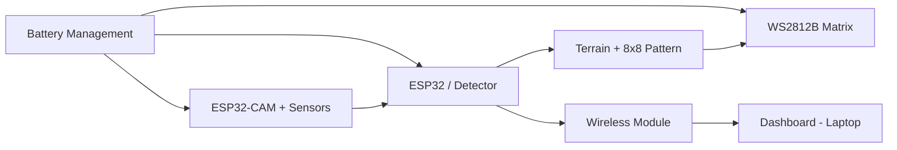

# System Architecture

## Layers of the Suit
1. **Adaptive camouflage pixel layer** – WS2812B LED matrix (outer layer)
2. **Flexible pixel driver layer**
3. **Protective (armour) layer**
4. **Electronics & control layer** – ESP32
5. **Inner lining (comfort layer)** – flexibility and ventilation

## Data Flow

## Components
| Component | Role |
|-----------|------|
| ESP32-CAM | Captures the surrounding environment |
| Environmental sensors | Gas, PM, temperature, humidity, light |
| ESP32 | Processes data, decides camouflage pattern |
| WS2812B 8x8 matrix | Displays colour / pattern |
| FTDI USB-to-TTL | Programming and serial communication |
| Power source | Battery supply to the whole system |
| Laptop | Programming, monitoring, testing |

## Software Modules
- `detector.py` – averages image colour, matches it to the closest terrain (Forest, Grassland, Soil, Road, Building), returns confidence and an 8x8 RGB pattern.
- `run.py` – Flask API: collector start/stop, sensor readings, detection, CSV data.
- `index.html`, `style.css`, `app.js` – dashboard UI.

## Future Scope
Scale from the 8x8 prototype to a full suit, add thermal/IR matching, on-device ML on the ESP32, and wireless team monitoring.
